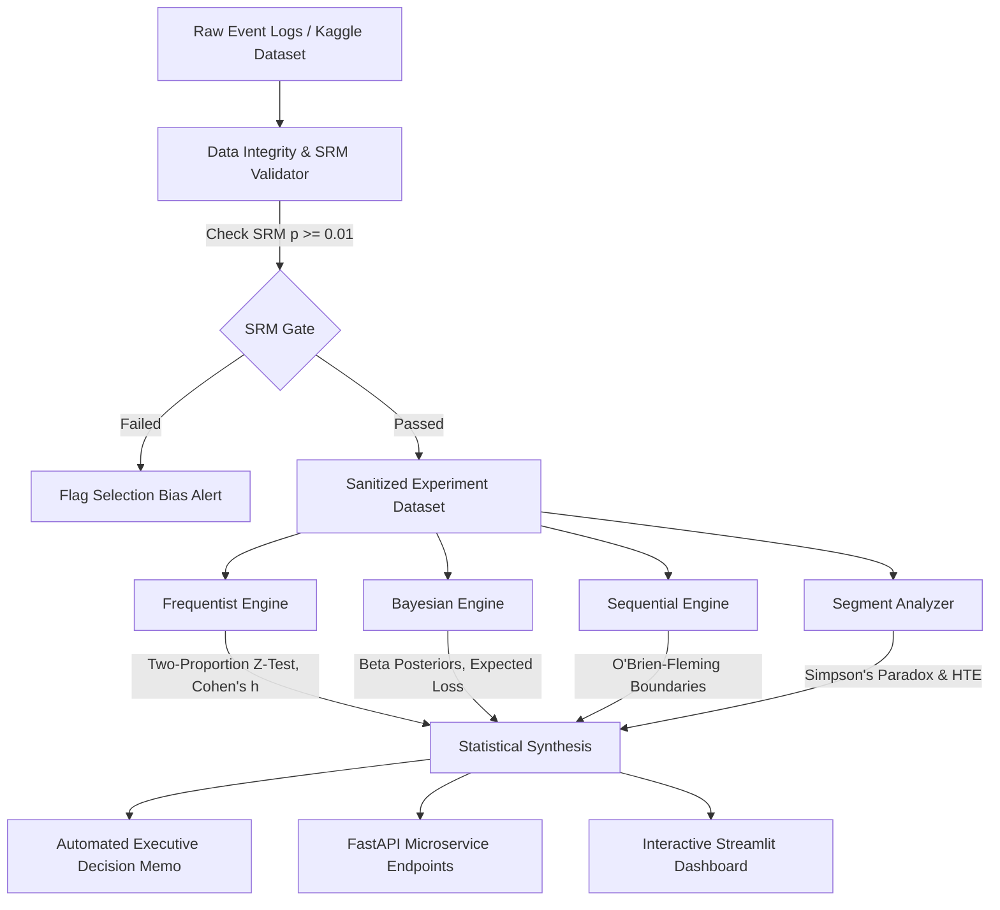

# Statistical A/B Testing & Experimentation Analytics Engine
### *Production-Grade Dual Frequentist & Bayesian Experimentation Platform*

[](https://github.com/AvijeetTiwari3/ab-testing-experimentation-engine)
[](https://www.python.org/)
[](https://ab-testing-experimentation-engine-5odwbn9didoy4k7udzlaz3.streamlit.app/)
[](https://fastapi.tiangolo.com/)
[](LICENSE)
[](Dockerfile)

> 🚀 **Live Interactive Dashboard:** [https://ab-testing-experimentation-engine-5odwbn9didoy4k7udzlaz3.streamlit.app/](https://ab-testing-experimentation-engine-5odwbn9didoy4k7udzlaz3.streamlit.app/)

---

## 📌 Executive Summary

Modern tech leaders—including Google, Netflix, and Airbnb—rely on online controlled experiments (A/B testing) to de-risk high-stakes product decisions. However, standard experimentation tools often suffer from **p-hacking, the continuous peeking problem, unmitigated Sample Ratio Mismatch (SRM), and false positive explosions in multi-metric scorecards**.

This repository delivers an **enterprise-grade, production-hardened Experimentation Analytics Engine** engineered to Google Data Scientist standards. It integrates:
1. **Pre-Experiment Power & Sample Sizing:** Two-proportion analytical sizing with power curve simulation.
2. **Data Integrity & SRM Auditing:** Automated detection and purging of contaminated exposures and $\chi^2$ Sample Ratio Mismatch testing.
3. **Dual-Engine Inferences:** Simultaneous **Frequentist** (Two-Proportion Z-test, Wald CI, Cohen's $h$) and **Bayesian** (Beta-Binomial conjugate posteriors, Highest Density Interval, Expected Loss Risk Theory, and ROPE).
4. **Sequential Testing (Peeking Control):** O'Brien-Fleming alpha-spending boundary calibration to eliminate the $22\%\to30\%$ false positive inflation caused by continuous daily monitoring.
5. **Multiple Testing Correction:** False Discovery Rate (FDR) control via Benjamini-Hochberg and Family-Wise Error Rate (FWER) control via Bonferroni/Holm algorithms.
6. **Heterogeneous Treatment Effects (HTE):** Cohort deconstruction across geographies with automated Simpson's Paradox detection.
7. **Production Microservice & Dashboard:** Modular FastAPI REST API and interactive Streamlit web dashboard.

---

## 🏛️ System Architecture



---

## 🔬 Empirical Benchmark: Real-World E-Commerce A/B Experiment

The engine was evaluated on a verified **294,478-row Kaggle E-Commerce landing page A/B test** across 23 days of live traffic:

### 1. Data Integrity & SRM Audit
- **Raw Exposure Records:** `294,478`
- **Contaminated Mismatches Purged:** `3,893` (users assigned to Control but delivered the Treatment page, or vice versa)
- **Duplicate Reactivations Deduplicated:** `1`
- **Clean Verified Unique Users:** `290,584`
- **Sample Ratio Mismatch Test:** $\chi^2 = 0.0045, p = 0.9468$ ($\gg 0.01$). **Randomization was immaculate (50.006% vs. 49.994%).**

### 2. Dual-Engine Statistical Synthesis

| Statistical Metric | Control (`old_page`) | Treatment (`new_page`) | Delta / Inferences |
|---|---|---|---|
| **Visitors ($N$)** | `145,274` | `145,310` | 50.0% / 50.0% split |
| **Conversions ($k$)** | `17,489` | `17,264` | -225 conversions |
| **Conversion Rate ($\hat{p}$)** | **12.04%** | **11.88%** | **-1.31% relative lift** |
| **Two-Proportion $Z$-Statistic** | — | — | **$Z = -1.3109$** |
| **Two-Sided $P$-Value** | — | — | **$p = 0.1899$ (Not Significant at $\alpha=0.05$)** |
| **95% Confidence Interval** | — | — | **$[-0.39\%, +0.08\%]$ (Spans zero)** |
| **Cohen's $h$ Effect Size** | — | — | **$-0.0049$ (Negligible effect size)** |
| **Bayesian $P(\text{Trt} > \text{Ctrl})$** | — | — | **Only $9.37\%$ probability of superiority** |
| **Bayesian Expected Loss (Risk)** | — | — | **Treatment carries $31\times$ higher risk of loss** |
| **ROPE Probability ($|\Delta| < 0.1\%$)**| — | — | **$29.76\%$** |

> ### 🛑 Strategic Business Recommendation
> **RETAIN CONTROL VARIANT (DO NOT SHIP).**  
> The new page design failed to achieve statistical significance ($p = 0.1899$) and carries a negative point estimate ($-1.31\%$ lift). Deploying the variant would introduce measurable business downside without upside.

---

## 🧮 Mathematical Rigor

### 1. Pre-Experiment Power Sizing
Given baseline $p_1$, target $p_2 = p_1 + \text{MDE}$, significance $\alpha$, and power $1 - \beta$:
$$n = \left[ \frac{z_{1 - \alpha/2} \sqrt{2 \bar{p}(1 - \bar{p})} + z_{1 - \beta} \sqrt{p_1(1 - p_1) + p_2(1 - p_2)}}{p_2 - p_1} \right]^2$$

### 2. Bayesian Beta-Binomial Conjugacy
Under uniform prior $\text{Beta}(\alpha_0=1, \beta_0=1)$ and likelihood $k \sim \text{Binomial}(n, p)$, the posterior is:
$$p \mid k, n \sim \text{Beta}(\alpha_0 + k, \; \beta_0 + n - k)$$
Risk is computed as expected loss under posterior draws $\theta \sim p(\theta \mid \mathcal{D})$:
$$\mathcal{R}(\text{Choose Treatment}) = \int \max(p_{\text{ctrl}} - p_{\text{trt}}, 0) \, dP$$

### 3. O'Brien-Fleming Alpha-Spending Function
At information fraction $t = \frac{n_t}{N_{\text{max}}}$, the critical $Z$-boundary is calibrated via:
$$z_{\text{crit}}(t) = \frac{z_{\alpha/2}}{\sqrt{t}}, \quad \alpha(t) = 2 \left(1 - \Phi(z_{\text{crit}}(t))\right)$$

---

## 🚀 REST API Documentation

The FastAPI service exposes enterprise endpoints:

| Method | Endpoint | Description |
|---|---|---|
| `GET` | `/health` | Liveness & platform telemetry check |
| `POST` | `/power-analysis/sample-size` | Compute sample size & power curve |
| `POST` | `/power-analysis/mde` | Compute MDE given fixed sample size |
| `POST` | `/analyze/frequentist` | Run Two-Proportion Z-Test with Cohen's $h$ |
| `POST` | `/analyze/bayesian` | Run Beta-Binomial Bayesian test with Expected Loss |
| `POST` | `/analyze/multiple-testing`| Apply Bonferroni, Holm, & BH-FDR corrections |
| `GET` | `/analyze/empirical-readout`| Full executive readout on real Kaggle dataset |

### Quick API Call Example:
```bash
curl -X POST "http://localhost:8000/analyze/frequentist" \
     -H "Content-Type: application/json" \
     -d '{
       "control_conversions": 17489,
       "control_total": 145274,
       "treatment_conversions": 17264,
       "treatment_total": 145310,
       "alpha": 0.05,
       "mde": 0.005
     }'
```

---

## 💻 Local Quickstart

### 1. Clone & Set Up Virtual Environment
```bash
git clone https://github.com/AvijeetTiwari3/ab-testing-experimentation-engine.git
cd ab-testing-experimentation-engine

python -m venv venv
source venv/bin/activate  # Windows: venv\Scripts\activate
pip install -r requirements.txt
```

### 2. Run Data Pipeline & Validation
```bash
python src/data_validator.py
```

### 3. Launch FastAPI REST Service
```bash
uvicorn api.app:app --host 0.0.0.0 --port 8000 --reload
# Interactive Swagger documentation available at: http://localhost:8000/docs
```

### 4. Launch Interactive Streamlit Dashboard
```bash
streamlit run dashboard/streamlit_app.py
# Dashboard opens automatically at: http://localhost:8501
```

### 5. Execute Test Suite
```bash
pytest tests/ -v
```

---

## 🐳 Docker Deployment

Build and run containerized service:
```bash
docker build -t ab-testing-engine .
docker run -p 8000:8000 ab-testing-engine
```

---

## 👨‍💻 Author

**Avijeet Tiwari**  
Aspiring Data Scientist | Large-Scale Experimentation & Applied Statistics  
- GitHub: [@AvijeetTiwari3](https://github.com/AvijeetTiwari3)

---

## 📜 License
Licensed under the [MIT License](LICENSE).
