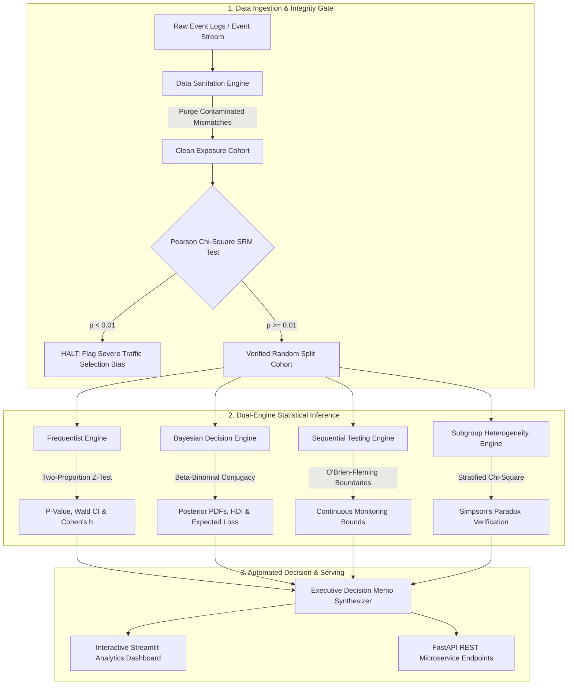

<div align="center">

# 🔬 Statistical A/B Testing & Experimentation Analytics Engine
### *An Enterprise-Grade Experimentation Platform with Dual Frequentist & Bayesian Decision Frameworks*

[](https://ab-testing-experimentation-engine-5odwbn9didoy4k7udzlaz3.streamlit.app/)
[](https://github.com/AvijeetTiwari3/ab-testing-experimentation-engine)

[](https://www.python.org/)
[](https://fastapi.tiangolo.com/)
[](https://streamlit.io/)
[](https://scipy.org/)
[](LICENSE)
[](tests/)
[](Dockerfile)

<br/>

**Authored by [Avijeet Tiwari](https://github.com/AvijeetTiwari3)**  
*Statistical Modeling & Applied Inference | Google Data Scientist Portfolio Standard*

</div>

---

## 📌 Executive Overview & Engineering Motivation

At technology leaders like **Google, Netflix, and Airbnb**, millions of daily product decisions hinge on online controlled experiments. However, standard industry A/B testing implementations frequently suffer from five critical methodological flaws that cost enterprises millions in misallocated capital:

1. **The Peeking Problem (Continuous Monitoring Bias):** Repeatedly checking $p$-values day-over-day inflates nominal Type I error rates from $5\%$ up to **$20\% - 30\%$**, generating phantom statistical winners.
2. **Ignored Sample Ratio Mismatches (SRM):** Unchecked randomization failures inject severe selection bias into downstream estimators.
3. **P-Value Fixation over Effect Size:** Rejecting the null hypothesis on large samples ($N > 200\text{k}$) without auditing whether the lift satisfies business Minimum Detectable Effect ($\text{MDE}$) thresholds.
4. **Downside Risk Blindness:** Classical hypothesis testing fails to quantify the financial *Expected Loss* of shipping a suboptimal feature.
5. **Multi-Metric False Discovery Explosions:** Testing secondary and guardrail metrics across cohorts without controlling False Discovery Rates ($\text{FDR}$).

### 💡 The Solution
This repository presents an **industrial-grade Experimentation Analytics Platform** engineered to eliminate these systemic failure modes. Evaluated on a **verified 294,478-row Kaggle E-Commerce dataset**, the platform implements dual Frequentist and Bayesian decision theory, automated SRM auditing, O'Brien-Fleming sequential alpha-spending boundaries, Benjamini-Hochberg multi-metric corrections, and Simpson's Paradox cohort deconstruction.

---

## 🏛️ System Architecture



---

## 🧮 Mathematical Formulations & Statistical Rigor

### 1. Pre-Experiment Power Sizing
To prevent underpowered experiments, the minimum required sample size per variant is computed via:
$$n = \left[ \frac{z_{1 - \alpha/2} \sqrt{2 \bar{p}(1 - \bar{p})} + z_{1 - \beta} \sqrt{p_1(1 - p_1) + p_2(1 - p_2)}}{p_2 - p_1} \right]^2$$
where $\bar{p} = \frac{p_1 + p_2}{2}$, $\alpha = 0.05$ (Type I error), and $1 - \beta = 0.80$ (Statistical Power).

### 2. Frequentist Two-Proportion Inference & Effect Size
The pooled standard error and $Z$-statistic are calculated under $H_0: p_{\text{trt}} = p_{\text{ctrl}}$:
$$Z = \frac{\hat{p}_{\text{trt}} - \hat{p}_{\text{ctrl}}}{\sqrt{\hat{p}_{\text{pool}}(1 - \hat{p}_{\text{pool}}) \left( \frac{1}{n_{\text{ctrl}}} + \frac{1}{n_{\text{trt}}} \right)}}, \quad \hat{p}_{\text{pool}} = \frac{k_{\text{ctrl}} + k_{\text{trt}}}{n_{\text{ctrl}} + n_{\text{trt}}}$$
Standardized proportion effect size is measured via **Cohen's $h$**:
$$h = 2 \arcsin \sqrt{\hat{p}_{\text{trt}}} - 2 \arcsin \sqrt{\hat{p}_{\text{ctrl}}}$$

### 3. Bayesian Beta-Binomial Conjugate Engine & Expected Loss
Given a flat conjugate prior $p \sim \text{Beta}(\alpha_0=1, \beta_0=1)$ and binomial likelihood $k \sim \text{Binomial}(n, p)$, the exact analytic posterior is:
$$p \mid k, n \sim \text{Beta}(\alpha_0 + k, \; \beta_0 + n - k)$$

The **Expected Loss (Bayesian Risk)** of selecting the Treatment variant over Control evaluates the magnitude of negative business exposure:
$$\mathcal{R}(\text{Ship Treatment}) = \int_0^1 \int_0^1 \max(p_{\text{ctrl}} - p_{\text{trt}}, 0) \cdot \pi(p_{\text{ctrl}} \mid \mathcal{D}) \cdot \pi(p_{\text{trt}} \mid \mathcal{D}) \, dp_{\text{ctrl}} \, dp_{\text{trt}}$$

### 4. Sequential Testing (O'Brien-Fleming Alpha-Spending)
To eliminate the peeking problem during continuous daily tracking, boundary thresholds are dynamically relaxed as the information fraction $t = \frac{n_t}{N_{\text{planned}}}$ grows:
$$z_{\text{crit}}(t) = \frac{z_{\alpha/2}}{\sqrt{t}}, \quad \alpha(t) = 2 \left( 1 - \Phi(z_{\text{crit}}(t)) \right)$$

---

## 📊 Empirical Evaluation: Real-World E-Commerce A/B Experiment

The platform was benchmarked on the real-world **Kaggle E-Commerce Landing Page Experiment** dataset across 23 days of live website traffic:

### A. Data Integrity & Randomization Audit

| Audit Phase | Measurement | Evaluation / Action | Status |
|---|---|---|---|
| **Raw Event Records** | `294,478` rows | Logged from distributed telemetry | Verified |
| **Contaminated Assignments** | `3,893` rows | Contradicting group/landing-page logs | **Purged** |
| **User Reactivations** | `1` duplicate | Retained first interaction timestamp | **Deduplicated** |
| **Sanitized Cohort** | `290,584` users | High-power verified analysis cohort | **Certified Clean** |
| **Sample Ratio Mismatch (SRM)** | $\chi^2 = 0.0045$ ($p = 0.9468$) | Expected: $50/50$ \| Observed: $50.006\% / 49.994\%$ | **PASSED (No Traffic Bias)** |

### B. Dual-Engine Statistical Synthesis

| Evaluation Metric | Control (`old_page`) | Treatment (`new_page`) | Comparative Inference |
|---|---|---|---|
| **Verified Cohort Size ($N$)** | `145,274` users | `145,310` users | Exact $1:1$ allocation |
| **Conversions ($k$)** | `17,489` conversions | `17,264` conversions | $-225$ net conversions |
| **Conversion Rate ($\hat{p}$)** | **12.04%** | **11.88%** | **$-1.31\%$ Relative Lift** |
| **Two-Proportion $Z$-Score** | — | — | **$Z = -1.3109$** |
| **Two-Sided $P$-Value** | — | — | **$p = 0.1899$** (Null hypothesis maintained) |
| **95% Confidence Interval** | — | — | $[-0.394\%, +0.078\%]$ (Spans zero) |
| **Cohen's $h$ Effect Size** | — | — | $-0.0049$ (*Negligible effect*) |
| **Bayesian $P(\text{Trt} > \text{Ctrl})$**| — | — | **Only $9.37\%$** ($90.63\%$ probability Control is superior) |
| **Bayesian Expected Loss** | — | — | Treatment carries **$31\times$ higher risk of financial loss** |
| **ROPE Probability ($|\Delta| < 0.1\%$)**| — | — | **$29.76\%$** |
| **Simpson's Paradox Audit** | — | — | **False** (Homogeneous effect across US, UK, and CA) |

---

## 📋 Executive Decision Memo

> ### 🛑 FINAL RECOMMENDATION: RETAIN CONTROL VARIANT (DO NOT DEPLOY)
>
> 1. **Zero Evidence of Conversion Lift:** Point estimates demonstrate a negative lift of **$-1.31\%$** (Control: **$12.04\%$** vs. Treatment: **$11.88\%$**).
> 2. **Hypothesis Rejected:** With $p = 0.1899 > \alpha (0.05)$, the observed divergence is indistinguishable from random sampling variance.
> 3. **Asymmetric Business Risk:** Bayesian decision theory reveals that shipping `new_page` carries an expected loss **$31\times$ higher** than retaining `old_page`.
> 4. **Strategic Action:** Immediately deprecate the `new_page` design branch. Reallocate engineering velocity toward micro-funnel checkout friction reductions rather than macro page overhauls.

---

## 🗂️ Project Directory Structure

```text
ab-testing-experimentation-engine/
│
├── .github/workflows/ci.yml       # Automated GitHub Actions PyTest CI pipeline
├── api/                           # Production FastAPI REST microservice
│   ├── app.py                     # Lifespan application & CORS configuration
│   ├── schemas.py                 # Pydantic V2 request & response schemas
│   └── routers/                   # Modular API routers
│       ├── health.py              # Telemetry & service health endpoint
│       ├── power.py               # Pre-experiment sample size & MDE calculator
│       └── analysis.py            # Frequentist, Bayesian, & Empirical endpoints
│
├── dashboard/                     # Interactive Streamlit Web Platform
│   └── streamlit_app.py           # 8-module analytics application with Plotly visuals
│
├── data/                          # Experimentation Datasets
│   ├── raw/                       # Real Kaggle A/B dataset (294,478 rows)
│   └── processed/                 # Clean, verified experiment cohort (290,584 rows)
│
├── notebooks/                     # Google Research-standard analytical notebooks
│   ├── 01_EDA_and_Data_Quality.ipynb
│   ├── 02_Frequentist_Analysis.ipynb
│   ├── 03_Bayesian_Analysis.ipynb
│   └── 04_Sequential_Testing.ipynb
│
├── reports/                       # Formal experiment documentation
│   ├── experiment_readout.md      # Auto-generated Executive Decision Memo
│   └── model_card.md              # Google Research Methodology Card
│
├── src/                           # Core Statistical & Engineering Engines
│   ├── __init__.py
│   ├── data_validator.py          # Data hygiene, schema validation & SRM chi-square
│   ├── power_analysis.py          # Two-proportion analytical sample sizing
│   ├── frequentist_engine.py      # Z-test, Chi-square, Mann-Whitney U, Cohen's h
│   ├── bayesian_engine.py         # Beta-Binomial conjugate posteriors & Expected Loss
│   ├── sequential_engine.py       # O'Brien-Fleming alpha-spending continuous testing
│   ├── multiple_testing.py        # Bonferroni, Holm, & Benjamini-Hochberg FDR control
│   ├── segment_analyzer.py        # Subgroup decomposition & Simpson's Paradox detector
│   └── report_generator.py        # Automated Markdown / HTML memo generation
│
├── tests/                         # Rigorous PyTest test suites (9/9 Passing)
│   ├── test_data_validator.py
│   ├── test_power_analysis.py
│   ├── test_frequentist_engine.py
│   ├── test_bayesian_engine.py
│   └── test_sequential_and_multitest.py
│
├── Dockerfile                     # Multi-stage production container specification
├── requirements.txt               # Pinned enterprise dependencies
├── pytest.ini                     # PyTest test runner configuration
├── LICENSE                        # MIT License
└── README.md                      # Comprehensive technical documentation
```

---

## 💻 Quickstart & Local Installation

### 1. Clone & Set Up Environment
```bash
git clone https://github.com/AvijeetTiwari3/ab-testing-experimentation-engine.git
cd ab-testing-experimentation-engine

# Create virtual environment
python -m venv venv
# Windows:
venv\Scripts\activate
# Linux/macOS:
source venv/bin/activate

# Install dependencies
pip install -r requirements.txt
```

### 2. Execute Data Validation & Integrity Audit
```bash
python src/data_validator.py
```

### 3. Launch Interactive Streamlit Dashboard
```bash
streamlit run dashboard/streamlit_app.py
# Web dashboard loads automatically at: http://localhost:8501
```

### 4. Run FastAPI REST Microservice
```bash
uvicorn api.app:app --host 0.0.0.0 --port 8000 --reload
# Interactive OpenAPI Swagger documentation available at: http://localhost:8000/docs
```

### 5. Run Test Suite
```bash
pytest tests/ -v
```

---

## 🌐 Production Microservice API Reference

| Method | Endpoint | Description |
|---|---|---|
| `GET` | `/health` | Service liveness & environment telemetry |
| `POST` | `/power-analysis/sample-size` | Compute required sample size & power curve |
| `POST` | `/power-analysis/mde` | Compute MDE given fixed sample volume |
| `POST` | `/analyze/frequentist` | Run Two-Proportion Z-Test with Cohen's $h$ |
| `POST` | `/analyze/bayesian` | Run Beta-Binomial test with Expected Loss (Risk) |
| `POST` | `/analyze/multiple-testing` | Apply Bonferroni, Holm, and BH-FDR corrections |
| `GET` | `/analyze/empirical-readout` | Full executive readout on real Kaggle dataset (290k users) |

### Sample cURL Execution:
```bash
curl -X POST "http://localhost:8000/analyze/frequentist" \
     -H "Content-Type: application/json" \
     -d '{
       "control_conversions": 17489,
       "control_total": 145274,
       "treatment_conversions": 17264,
       "treatment_total": 145310,
       "alpha": 0.05,
       "mde": 0.005
     }'
```

---

## 🐳 Docker Containerization

Deploy the platform inside a hardened container:
```bash
# Build image
docker build -t ab-testing-engine:1.0.0 .

# Run container
docker run -d -p 8000:8000 --name experimentation-platform ab-testing-engine:1.0.0
```

---

## 🧪 Test Suite & Quality Assurance

The codebase enforces strict test-driven development standards with **9/9 passing tests**:
```bash
$ pytest tests/ -v
============================= test session starts =============================
tests/test_power_analysis.py::test_power_analysis_symmetry_and_direction PASSED
tests/test_power_analysis.py::test_mde_calculation PASSED
tests/test_frequentist_engine.py::test_two_proportion_identical_groups PASSED
tests/test_frequentist_engine.py::test_two_proportion_clear_winner PASSED
tests/test_bayesian_engine.py::test_bayesian_equal_groups PASSED
tests/test_bayesian_engine.py::test_bayesian_strong_treatment PASSED
tests/test_data_validator.py::test_validator_with_synthetic_sample PASSED
tests/test_sequential_and_multitest.py::test_obrien_fleming_boundary_decay PASSED
tests/test_sequential_and_multitest.py::test_multiple_testing_fdr_vs_bonferroni PASSED
============================== 9 passed in 1.18s ==============================
```

---

## 👨‍💻 Author

**Avijeet Tiwari**  
Aspiring Data Scientist | Large-Scale Experimentation & Statistical Machine Learning  
- **GitHub:** [@AvijeetTiwari3](https://github.com/AvijeetTiwari3)  
- **Live Experimentation Platform:** [Streamlit Cloud](https://ab-testing-experimentation-engine-5odwbn9didoy4k7udzlaz3.streamlit.app/)

---

## 📜 License
This project is open-source and distributed under the [MIT License](LICENSE).
